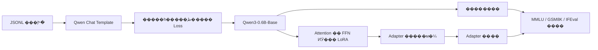

# Qwen3-0.6B LoRA SFT

**A reproducible, small-scale supervised fine-tuning and evaluation workflow for Qwen3 Base**

����һ������չʾ������ģ�Ͳ�����Ч΢�������Ķ�����Ŀ��Ĭ�ϻ���Ϊ [Qwen/Qwen3-0.6B-Base](https://huggingface.co/Qwen/Qwen3-0.6B-Base)���������С�Դ��豸����Ŀʵ���˶��ֶԻ�Ԥ������LoRA ѵ�����ı����ɣ��Լ������� adapter �� MMLU��GSM8K��IFEval ����������ڡ�

> **��ǰ״̬��** �ֿ��ṩѵ����������뼰��С����д���������������������о����ݣ�0.6B ģ�͵�ѵ��Ч��������Ч����Loss���Դ�ͻ�׼������δʵ�⣬��Ԥ����Ʋ⡣

## �����

- �ڹ̶����������ݻ��֡�ѵ��Ԥ������������£�LoRA �ܷ�����ض�ָ�������ϵı��֣�
- Rank��Alpha��Dropout �ı�ʱ��ѵ������������������������α仯��
- ָ����ѭ��֪ʶ�������ѧ�����Ƿ���ֲ�ͬ�ı仯���ƣ�

��Щ������Ҫ��ʵ�������ظ�ʵ�飻����ĿĿǰ�ṩ��ִ�е��о����̣�����������������

## ��������



LoRA Ŀ��ģ��Ϊ `q_proj`��`k_proj`��`v_proj`��`o_proj`��`gate_proj`��`up_proj`��`down_proj`��Ĭ�� `r=8`��`alpha=16`��`dropout=0.05`����Щ����ʾ��㣬���ǵ��Ž��ۡ�ѵ���ű���¼ģ��/��ѵ����������������ӡ�������ѵ������֤ Loss ��ʷ����ʱ�� CUDA ��ֵ�Դ档�����������˲����������ض�Ŀ��ظ���

## �ֿ�ṹ

```text
qwen3-0.6b-lora-sft/
������ src/qwen_lora/        # ���ݴ�����ѵ��ʵ��
������ scripts/evaluate.py  # ����/adapter ��׼����
������ examples/             # �������������������������
������ tests/                # ���ݴ����������������
������ docs/PLAN.md          # ��Ʊ߽���׶μ�¼
������ train.py
������ generate.py
������ requirements.txt
������ requirements-eval.txt
������ pyproject.toml
```

## �����밲װ

���� Python 3.10+���� CUDA GPU ʱ�Զ�ʹ�� GPU������ʹ�� CPU������΢���� CPU �Ͽ��ܺ�������װ PyTorch ʱ����� [�ٷ���װָ��](https://pytorch.org/get-started/locally/)ѡ���뱾��ƥ��� CUDA/CPU �汾���������Ŀ��Ŀ¼���У�

```bash
python -m venv .venv
# Windows: .venv\Scripts\activate
# Linux/macOS: source .venv/bin/activate
python -m pip install -r requirements.txt
python -m pip install -e '.[test]'  # �����е�Ԫ����ʱ��Ҫ
```

��ѡ 4bit ������`python -m pip install -e '.[quant]'`����׼���⣺`python -m pip install -r requirements-eval.txt`�������汾��Χ�� `pyproject.toml`��Ҫ�ϸ���һ��ʵ�飬����̶�ʵ�ʰ�װ�汾��ģ�� revision�����ݼ��汾���豸���ã����м�¼�ᱣ����Ҫ������Ϣ��

## ���ݸ�ʽ

һ��һ�� JSON ����`messages` ��������������Ϊ `user`��`assistant`�����԰���ǰ��Ķ�����ʷ��

```json
{"messages":[{"role":"user","content":"ʲô�� LoRA��"},{"role":"assistant","content":"LoRA ʹ�õ��Ⱦ����ʾȨ�ظ��¡�"}]}
```

�ű�ʹ��ģ���Դ��� Chat Template���������ʾǰ׺�Ƿ��������Ի�һ�¡������һ�����ֻظ����������Dz�����ʧ���㣻��ʷ��Ϣ���û���Ϣ�� padding �ı�ǩΪ `-100`��ͬһ����Ի��IJ�ͬ�𰸱�����ͬһ�����ݼ��࣬�Խ���й©���ա�������ʵ�о�ǰ�˲�������Դ������֤����˽��Ϣ���������׼���ص���

## ����

```bash
# ֻ��������ʾ��examples �����ݺ���
python train.py --data examples/toy_conversations.jsonl --output outputs/demo

# ��ʵʵ�飺�滻Ϊ�������Ҿ���ϴ�� JSONL
python train.py --data data/train.jsonl --output outputs/experiment-01 \
  --rank 8 --alpha 16 --dropout 0.05 --seed 42 --max-steps 200

# ����
python generate.py --adapter outputs/demo/adapter --prompt "����� LoRA��"

# �Ȳ鿴�������ȥ�� --dry-run ��ʵ������������׼
python scripts/evaluate.py --adapter outputs/demo/adapter --dry-run
python scripts/evaluate.py --adapter outputs/demo/adapter

# ��Ԫ����
python -m pytest -q
```

`outputs/<run>/run.json` ����ѵ��/��֤ Loss����������������ӡ��汾����ʱ���Դ��ֵ��`outputs/evaluation/` ������������������嵥��`outputs/`���������ݺ�Ȩ�ؾ��� Git ���ԡ�

## ʵ����������

| ��Ŀ | ��ǰ��� |
| --- | --- |
| LoRA ѵ�� Loss / ��֤ Loss | ��ʵ��ѵ����д |
| ��ֵ�Դ� / ѵ����ʱ | ��ʵ��ѵ����д |
| MMLU / GSM8K / IFEval ������ adapter ���� | ��ʵ��������д |

��ִ�е�������飺`pytest -q` Ϊ **6 passed**���ٷ� Qwen3-0.6B-Base tokenizer �Ե��������������Ŀ���ǩ���ͨ���������ʼ���ļ�С Qwen3 ������� 1 �� LoRA ѵ������֤���ü��ֻ��֤������·�����ǹٷ� 0.6B Ȩ�ص�ѵ�������Ҳ�������������Ƚϡ�������׼����δ���С�

Ĭ����д����ֻ�ʺϼ����������0.6B ���������� 4B ���ȼۣ�����Դ�豸��ѵ������������������С��Ӱ����ۡ��Ƚϲ�ͬ����ʱ��Ӧ�̶�ģ�� revision�����ݻ��֡���ʾģ�塢shot ��������ű��汾��������ӣ����������ظ���Ρ�MMLU��GSM8K Ĭ�� 5-shot��IFEval 0-shot�������ʹ�� Chat Template�������Ӧ�������ͬһָ�ꡣ

## �������

- [Qwen3-0.6B-Base ģ�Ϳ�](https://huggingface.co/Qwen/Qwen3-0.6B-Base)���� [Apache-2.0 ����֤](https://huggingface.co/Qwen/Qwen3-0.6B-Base/blob/main/LICENSE)��ģ��Ȩ�ز������ڱ��ֿ��С�
- [Qwen3 Technical Report](https://arxiv.org/abs/2505.09388)��
- [Hugging Face Transformers](https://huggingface.co/docs/transformers/index)��[PEFT LoRA](https://huggingface.co/docs/peft/main/package_reference/lora)��[lm-evaluation-harness](https://github.com/EleutherAI/lm-evaluation-harness)��������Щ��ʵ��ѵ�������⣻δ������Դ���롣

���ֿ�ԭ��������� [MIT License](LICENSE)����Ŀ�� AI ����������д���о����⡢ʵ�����ͽ��������˹��������ʵ������֤��
