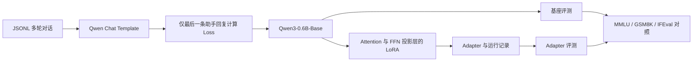

# Qwen3-0.6B LoRA SFT

**A reproducible, small-scale supervised fine-tuning and evaluation workflow for Qwen3 Base**

这是一个用于展示大语言模型参数高效微调方法的独立项目。默认基座为 [Qwen/Qwen3-0.6B-Base](https://huggingface.co/Qwen/Qwen3-0.6B-Base)，以适配较小显存设备。项目实现了多轮对话预处理、LoRA 训练、文本生成，以及基座与 adapter 的 MMLU、GSM8K、IFEval 对照评测入口。

> **当前状态：** 仓库提供训练与评测代码及极小的手写流程样例。样例不构成研究数据；0.6B 模型的训练效果、推理效果、Loss、显存和基准分数尚未实测，不预填或推测。

## 研究问题

- 在固定基座、数据划分、训练预算和评测设置下，LoRA 能否改善特定指令数据上的表现？
- Rank、Alpha、Dropout 改变时，训练参数量、收敛和评测结果如何变化？
- 指令遵循、知识理解和数学推理是否呈现不同的变化趋势？

这些问题需要真实数据与重复实验；本项目目前提供可执行的研究流程，不宣称能力提升。

## 方法概览



LoRA 目标模块为 `q_proj`、`k_proj`、`v_proj`、`o_proj`、`gate_proj`、`up_proj`、`down_proj`。默认 `r=8`、`alpha=16`、`dropout=0.05`；这些是演示起点，不是调优结论。训练脚本记录模型/可训练参数量、随机种子、环境、训练与验证 Loss 历史、耗时和 CUDA 峰值显存。长样本被过滤并计数，不截断目标回复。

## 仓库结构

```text
qwen3-0.6b-lora-sft/
├── src/qwen_lora/        # 数据处理与训练实现
├── scripts/evaluate.py  # 基座/adapter 基准调用
├── examples/             # 手写流程样例，不能用于效果结论
├── tests/                # 数据处理与评测命令测试
├── docs/PLAN.md          # 设计边界与阶段记录
├── train.py
├── generate.py
├── requirements.txt
├── requirements-eval.txt
└── pyproject.toml
```

## 环境与安装

建议 Python 3.10+，有 CUDA GPU 时自动使用 GPU，否则使用 CPU。完整微调在 CPU 上可能很慢。安装 PyTorch 时请根据 [官方安装指引](https://pytorch.org/get-started/locally/)选择与本机匹配的 CUDA/CPU 版本；随后在项目根目录运行：

```bash
python -m venv .venv
# Windows: .venv\Scripts\activate
# Linux/macOS: source .venv/bin/activate
python -m pip install -r requirements.txt
python -m pip install -e '.[test]'  # 仅运行单元测试时需要
```

可选 4bit 量化：`python -m pip install -e '.[quant]'`。标准评测：`python -m pip install -r requirements-eval.txt`。依赖版本范围见 `pyproject.toml`；要严格复现一次实验，还需固定实际安装版本、模型 revision、数据集版本和设备配置，运行记录会保存主要环境信息。

## 数据格式

一行一个 JSON 对象，`messages` 最后两项必须依次为 `user`、`assistant`；可以包含前面的多轮历史：

```json
{"messages":[{"role":"user","content":"什么是 LoRA？"},{"role":"assistant","content":"LoRA 使用低秩矩阵表示权重更新。"}]}
```

脚本使用模型自带的 Chat Template，并检查提示前缀是否与完整对话一致。仅最后一条助手回复及其结束标记参与损失计算；历史消息、用户消息和 padding 的标签为 `-100`。同一输入对话的不同答案被分在同一个数据集侧，以降低泄漏风险。请在真实研究前核查数据来源、许可证、隐私信息及与评测基准的重叠。

## 运行

```bash
# 只作流程演示：examples 中数据很少
python train.py --data examples/toy_conversations.jsonl --output outputs/demo

# 真实实验：替换为有许可且经清洗的 JSONL
python train.py --data data/train.jsonl --output outputs/experiment-01 \
  --rank 8 --alpha 16 --dropout 0.05 --seed 42 --max-steps 200

# 生成
python generate.py --adapter outputs/demo/adapter --prompt "请解释 LoRA。"

# 先查看评测命令；去掉 --dry-run 才实际运行三个基准
python scripts/evaluate.py --adapter outputs/demo/adapter --dry-run
python scripts/evaluate.py --adapter outputs/demo/adapter

# 单元测试
python -m pytest -q
```

`outputs/<run>/run.json` 保存训练/验证 Loss、参数量、随机种子、版本、耗时和显存峰值。`outputs/evaluation/` 保存评测输出和命令清单。`outputs/`、下载数据和权重均被 Git 忽略。

## 实验结果与限制

| 项目 | 当前结果 |
| --- | --- |
| LoRA 训练 Loss / 验证 Loss | 待实际训练填写 |
| 峰值显存 / 训练耗时 | 待实际训练填写 |
| MMLU / GSM8K / IFEval 基座与 adapter 分数 | 待实际评测填写 |

已执行的轻量检查：`pytest -q` 为 **6 passed**；官方 Qwen3-0.6B-Base tokenizer 对单轮与多轮样本的目标标签检查通过；随机初始化的极小 Qwen3 配置完成 1 步 LoRA 训练和验证。该检查只验证代码链路，不是官方 0.6B 权重的训练结果，也不能用于能力比较。完整基准评测未运行。

默认手写样例只适合检查数据流。0.6B 基座能力与 4B 不等价；低资源设备的训练步数、量化和批大小会影响结论。比较不同配置时，应固定模型 revision、数据划分、提示模板、shot 数、评测脚本版本及随机种子，并尽可能重复多次。MMLU、GSM8K 默认 5-shot，IFEval 0-shot，三项均使用 Chat Template；结果不应互相混作同一指标。

## 参考与许可

- [Qwen3-0.6B-Base 模型卡](https://huggingface.co/Qwen/Qwen3-0.6B-Base)及其 [Apache-2.0 许可证](https://huggingface.co/Qwen/Qwen3-0.6B-Base/blob/main/LICENSE)。模型权重不包含在本仓库中。
- [Qwen3 Technical Report](https://arxiv.org/abs/2505.09388)。
- [Hugging Face Transformers](https://huggingface.co/docs/transformers/index)、[PEFT LoRA](https://huggingface.co/docs/peft/main/package_reference/lora)、[lm-evaluation-harness](https://github.com/EleutherAI/lm-evaluation-harness)。调用这些库实现训练与评测；未复制其源代码。

本仓库原创代码采用 [MIT License](LICENSE)。项目由 AI 辅助设计与编写；研究问题、实验结果和结论仍需人工审查与真实运行验证。
